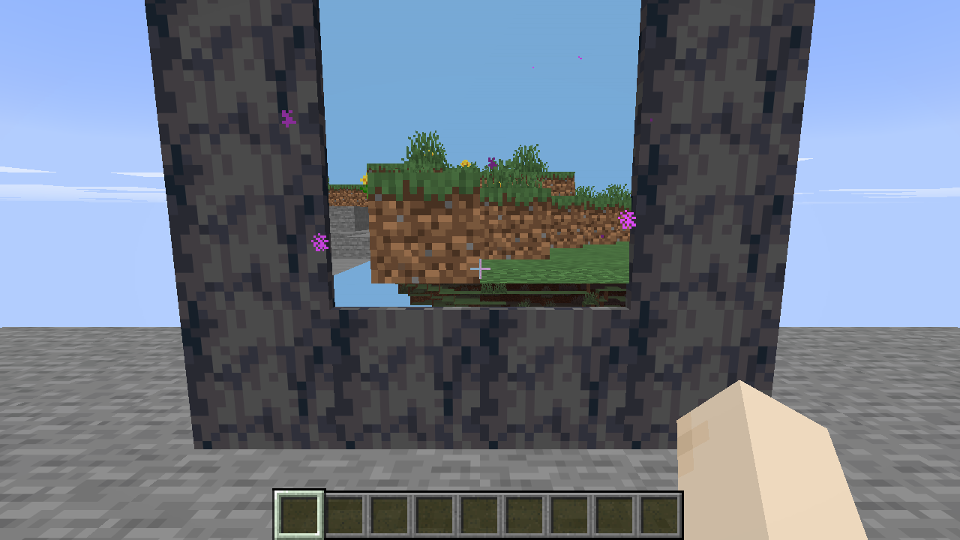

# Custom Dimensions Companion (26.3)

The optional client mod for `mods/custom-dimensions-26`: it draws a portal's
far side in the opening from the server's companion feed. It is effect-only
(decisions RB-03, RB-25): without it, or on a server without the feed, the
game looks and plays as vanilla, coloured portal and particles included.

Mod id `customdimensionsclient`, `environment: client`, Minecraft 26.3,
Java 25, Fabric Loader 0.20.1, Fabric API 0.164.0+26.3, Loom 1.19.3 without
remapping, no mixins. Its version equals the server mod's `mod_version`: the
server admits a hello only when the two strings match.



## What it draws

For each opening the server frames within 24 blocks:

- The destination's blocks from one layer past the opening out to 40 layers,
  read at `source + (dx, dy, dz)` and drawn at the source position, so the
  player's own eye is the camera on the far side. Block models come from the
  game's own model set with their textures, tints, directional shade and the
  destination's sky and block light from the chunk packet; water and lava
  tops are drawn with their still textures.
- The destination's sky colour behind them, and its fog colour mixed in from
  55% of the depth.

Every face is clipped on the CPU to the sightline cone through the opening
(four planes through the eye and the opening's edges, and the surface itself),
then moved along its own ray onto a slab 0.08 blocks deep just in front of the
portal pane. A point's place on screen does not change and depth order is
kept, so the far side covers the source world behind the portal, anything
standing in front of the portal still covers the far side, and the portal pane
fails the depth test wherever the far side is drawn. It all goes through one
`submitCustomGeometry` per opening in vanilla's cutout block render type from
Fabric's `LevelRenderEvents.COLLECT_SUBMITS`; no mixin is needed.

Any exception in the renderer switches it off for the session with one
`companion-off:` log line, and the portal draws as vanilla.

## The feed

Every channel of the server's wire contract
(`mods/custom-dimensions-26/README.md` § Wire contract) is mirrored in
`CompanionPayloads`, sharing no code with the server. Both projects pin the
same bytes in `companion-fixtures/*.hex`: the server's
`CompanionWireFixturesTest` writes them (`./gradlew :server:test
-PwriteFixtures`) and checks them, and this project's copy of that test
decodes and re-encodes each one with its own codecs.

On join the client sends `handshake/v2` with its version and
`portal-view/v2` (`renderLocally` true, `keepSlab` false, the render distance,
view depth 48). Every 10 seconds once the feed has sent anything it logs a
`companion-feed:` line with the frames, chunks received and held, entity
snapshots, handovers, entities held, clears, and openings and faces drawn.

## Compatibility

- **Iris:** while a shader pack is in use the far side stands down with one
  `companion-off: an Iris shader pack is in use` line and the portal draws as
  vanilla; it comes back with a `companion-on:` line when the pack is turned
  off. Iris is read through its public API by reflection and is not a
  dependency. A pack replaces the block pipeline and would light and shadow
  the squashed slab as if it stood in the opening.
- **Distant Horizons:** draws its LODs beyond the render distance and leaves
  the far side alone.

## The rig

```bash
cd mods/custom-dimensions-client-26
scripts/rig.sh            # variants a b c d; or name some: scripts/rig.sh b d
```

It boots the server mod's `runServer` on port 25665 (offline, level-seed
20261022) unless something already listens there, feeding its console from a
FIFO so it can send `stop` once the shots are taken, then runs `runClient` under
`xvfb-run` with Mesa llvmpipe once per variant. The client's rig hook
(`dev/Rig.java`, active only with `-Prig`) joins as the operator `Rig`, builds
a basalt frame on a platform at y 180, lights it with flint and steel through
the real use-item path into `adventure:the_basalt_spires`, stands in front of
it, screenshots it near and far and quits. Variants: `a` companion off (what
an unmodded client sees), `b` companion on, `c` with Iris and Complementary
Reimagined, `d` with Distant Horizons. Iris, its Sodium and Distant Horizons
come from the Modrinth maven by version id (`gradle.properties`); the shader
pack is downloaded into `run/shaderpacks/` and never committed.

```bash
scripts/rig.sh biomes shots.json   # the biome-shots mode
```

`biomes <shot list>` boots the server on the self-test definitions, whose
showcase levels `selftest_biome_<id>` each hold one library biome on
overworld terrain (Nether terrain for a Nether biome, the End's outer islands
round 1408, 0 for an End biome, floating islands for a sky biome), and runs one client with
the companion off through `dev/BiomeShots.java` (active only with `-Prig` and
`-PrigBiomes`). The list is a JSON array of `{dimension, x, y, z, yaw, pitch,
name}`, `y` a number, `"surface"` or `"surface+N"` (N blocks over the
client's motion-blocking height there) or `"ground"` or `"ground+N"` (over
the ground under trees and plants); `at: [x, y, z]` in place of `yaw` and
`pitch` faces that block. A cavern or Nether shot gives `y` as a number, since
the motion-blocking height there is the surface or the roof, and
`nightVision: true` lights it with night vision, which every other shot
clears. In spectator mode with the HUD hidden, at noon in clear
weather, the client enters each dimension with `/customdim tp`, teleports
over the spot, reads the surface once that chunk arrives, teleports to the
shot, waits until every chunk within six of the camera is loaded and every
visible section is drawn (at most a minute), screenshots
`<out>/screenshots/<name>.png` and quits after the last. A shot's `radius`
(chunks, default six) widens the ring that must be loaded first and `hold`
(seconds) waits that long after it is drawn, for far views.

Spectator mode draws through solid blocks, so the camera must be clear before
a screenshot: every block in the 3×3×3 box round the eye block has an empty
collision shape (water and lava are clear). A camera that is not is lifted a
block at a time, up to eight, with `rig: <name> camera lifted N` in the client
log at each step; one still not clear is skipped with `rig: <name> camera
inside terrain at x y z`, and the batch goes on. `check: true` on an entry
audits the camera without a screenshot: it waits for the chunks within its
`radius`, logs `rig: <name> camera clear`, `camera clear after lift N` (and
re-places the camera there) or the inside-terrain line, and takes the frame
census below.

Every screenshot and every `check` entry writes a frame census,
`<out>/screenshots/<name>.frame.json`: a 64×36 grid of rays from the eye
across the view (the options' field of view, the window's aspect), clipped
against block outlines and any fluid out to the render distance. Each hit
records its block, the biome there and its distance; a miss is sky, or
`unloaded` when the ray passed a chunk the client does not hold below the
skyline (the highest motion-blocking height of the loaded chunks). It gives
shares by block, by biome (of the rays that hit) and by distance band (under
32, 32–128, over 128 blocks), and a one-line `caption` built only from those
shares, which the client log repeats as `rig: <name> census <caption>`.

Three scripts turn the census and the server's survey into a review:

```bash
scripts/census-list.py /tmp/w8m/shots.json census.json --only the_greenreach   # accepted shots -> check entries
scripts/pick-shots.py <run>/customdim-survey/<slug>/dossier.json shots.json     # a survey -> a shot list
scripts/review-packet.py <slug> dossier.json shots.json <out>/screenshots review.md [--notes notes.md] [--facts facts.json]
```

`census-list.py` reads either accepted-shot record (the terrain picks'
`{slug, shots: [{camera: {x, y, z, yaw, pitch}, shows}]}` or the biome
gallery's `{biome, shots: [{dimension, camera: [x, y, z], at, what}]}`) and
writes `check` entries at the same cameras, the old caption kept beside each.
`pick-shots.py` reads the dossier of `/customdim survey <slug>` and writes a
far view from the coarse map's summit, one shot for every place type of each
layer (surface, sky islands, underground, roof) at its representative camera,
every landmark, and one shot per notable cluster type, rarest first.
`review-packet.py` sets the 1.21.1 definition (read only), the v2
definition, optional owner notes, the dossier's summary, a facts table and
every shot with its census caption side by side in `review.md`, ending with
the review questions, which the reviewer answers. The facts table is computed,
not judged (`--facts FILE` also writes it as JSON):

- **O rows**, one per 1.21.1 biome: its v2 id through
  `definitions/id-mapping.csv` (a vanilla id with no row maps to itself), its
  placed surface share and columns, its state (`expressed`, `placed, not
  expressed`, `listed, not found`, `not in v2 definition`, `no v2 id`) and the
  reason for a flag;
- **V rows**, one per placed v2 biome no 1.21.1 biome maps to;
- **M rows**, the dossier's top surface biomes, snow, water, lava, void,
  canopy, relief, layer and column-class numbers beside the 1.21.1 type,
  `noiseSettings`, `settingsOverrides` and `environment`;
- **the scorecard**: S:a the share of the ground columns whose biome traces to the
  1.21.1 list, S:b the share of the 1.21.1 biomes expressed, S:c the number of
  v2 biomes placed but not expressed, S:d each layer the 1.21.1 type implies
  (`sky_islands`, `nether_islands` and `end` a sky layer, which islands over void satisfy, since the survey files the lowest mass as the surface: void on 20% or more of the columns and ground on 5% or more; `nether` a surface
  and a roof; `cave` underground and a roof; the rest a surface and
  underground) and whether it is present (5% of columns or more). A base world
  has no 1.21.1 biome list, so S:a and S:b are n/a there.

**The rule:** every factual statement in an answer cites a facts row (`O3`,
`V1`, `M:snow`, `S:a`) or a dossier key (`surface.snowIcePercent`); a
statement nothing backs is left out, not guessed. A biome is absent only when
its row says so: a placed, unexpressed biome is present with a flag.

1. Taken together, do the shots show the world's dominant character as the dossier measures it?
2. Is every claim in the captions and descriptions supported by the frame census or the dossier? List the unsupported ones.
3. Which elements of the 1.21.1 description or biome list are absent from the dossier? Quote the O rows that are not expressed.
4. Which measured elements contradict the intent (for example, snow expected but snow cover under 5%)?
5. Fidelity to the 1.21.1 intent, 0–5, with one line why, citing the scorecard.

`scripts/test_review_packet.py` tests the facts table:
`python3 -m unittest discover -s scripts -p 'test_*.py'`.

**Targets.** `scripts/check-targets.py <dossier.json> <targets.json>` checks a
dossier against a dimension's measurable targets: each a dossier key path (or
several joined by ` + `, summed), an operator (`>=`, `<=`, `>`, `<`, `==`,
`between`) and a value, with the sentence of intent it comes from. It prints
PASS or FAIL with the measured value per target and exits 1 on any fail; an
unknown key is an error, and a registry id the dossier does not list measures 0.
`scripts/test_check_targets.py` tests it.

```bash
scripts/rig.sh --definitions ../custom-dimensions-26/definitions --dh --render-distance 12 biomes shots.json
```

`--definitions <dir>` runs the server on that folder instead of the self-test
definitions, so a shot list can name any dimension in it.
`--render-distance N` sets the client's render distance and the server's view
distance it starts with. `--dh` adds Distant Horizons to the biome-shots client
and to the server (`runServer -Pdh`), which generates the LODs the client asks
for; the client's quality defaults are the Medium preset (vertical and
horizontal quality MEDIUM) and it runs with 4 GB. Under Mesa llvmpipe on four
cores the LODs do not reach past the vanilla render distance within five
minutes, so the far views there use `--render-distance 32` instead. Each
dimension keeps its own clock, so every shot sets noon and clear weather in
its own dimension.

Xvfb's GLX offers no sRGB-capable visual, which the 26.3 client asks SDL for;
`rig/srgbshim.c` stands in for libGL and drops that attribute, so every
variant runs on OpenGL, the backend Iris uses.

The checked-in set is `docs/screens/`, scaled to 960 px wide.

## Not ported

- **Destination entities and projectiles are received, not drawn.** Snapshots
  and handovers are decoded, held per destination and counted in the feed
  line; drawing them needs the entity's model clipped to the opening, which
  the submit path for entity models does not offer.
- **The second-world renderer** (a whole `ClientLevel` and level renderer for
  the destination, drawn offscreen and composited in screen space): the far
  side is meshed from the fed chunks instead, so there is no live block
  animation, no translucency (water draws opaque), no ambient occlusion and
  no particles on the far side.
- **The projection/v3 slab, the fake-block store and its renderer**, which
  served the server-painted projection that RB-03 removes. `keepSlab` stays on
  the wire because the server expects it.
- **The settings screen and stored settings, the developer HTTP bridge and its
  actions, the arrival screen and the preloaded-transfer loading skip.**
  `preloaded/v1` is received and logged.
