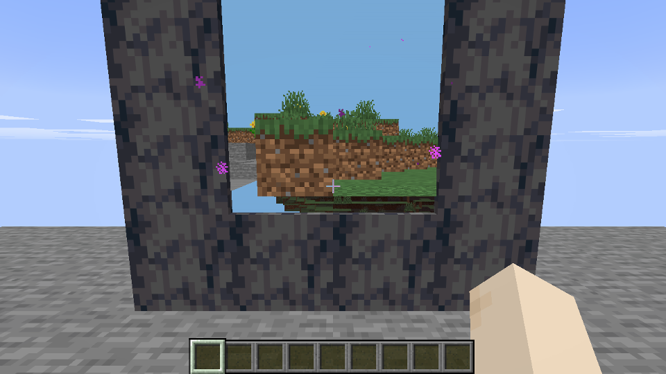

# Custom Dimensions Companion (26.3)

The optional client mod for `mods/custom-dimensions-26`: it draws a portal's
far side in the opening from the server's companion feed. It is effect-only
(decisions RB-03, RB-25): without it, or on a server without the feed, the
game looks and plays as vanilla, coloured portal and particles included.

Mod id `customdimensionsclient`, `environment: client`, Minecraft 26.3,
Java 25, Fabric Loader 0.20.1, Fabric API 0.164.0+26.3, Loom 1.19.3 without
remapping, no mixins. Its version equals the server mod's `mod_version`: the
server admits a hello only when the two strings match.



## What it draws

For each opening the server frames within 24 blocks:

- The destination's blocks from one layer past the opening out to 40 layers,
  read at `source + (dx, dy, dz)` and drawn at the source position, so the
  player's own eye is the camera on the far side. Block models come from the
  game's own model set with their textures, tints, directional shade and the
  destination's sky and block light from the chunk packet; water and lava
  tops are drawn with their still textures.
- The destination's sky colour behind them, and its fog colour mixed in from
  55% of the depth.

Every face is clipped on the CPU to the sightline cone through the opening
(four planes through the eye and the opening's edges, and the surface itself),
then moved along its own ray onto a slab 0.08 blocks deep just in front of the
portal pane. A point's place on screen does not change and depth order is
kept, so the far side covers the source world behind the portal, anything
standing in front of the portal still covers the far side, and the portal pane
fails the depth test wherever the far side is drawn. It all goes through one
`submitCustomGeometry` per opening in vanilla's cutout block render type from
Fabric's `LevelRenderEvents.COLLECT_SUBMITS`; no mixin is needed.

Any exception in the renderer switches it off for the session with one
`companion-off:` log line, and the portal draws as vanilla.

## The feed

Every channel of the server's wire contract
(`mods/custom-dimensions-26/README.md` § Wire contract) is mirrored in
`CompanionPayloads`, sharing no code with the server. Both projects pin the
same bytes in `companion-fixtures/*.hex`: the server's
`CompanionWireFixturesTest` writes them (`./gradlew :server:test
-PwriteFixtures`) and checks them, and this project's copy of that test
decodes and re-encodes each one with its own codecs.

On join the client sends `handshake/v2` with its version and
`portal-view/v2` (`renderLocally` true, `keepSlab` false, the render distance,
view depth 48). Every 10 seconds once the feed has sent anything it logs a
`companion-feed:` line with the frames, chunks received and held, entity
snapshots, handovers, entities held, clears, and openings and faces drawn.

## Compatibility

- **Iris:** while a shader pack is in use the far side stands down with one
  `companion-off: an Iris shader pack is in use` line and the portal draws as
  vanilla; it comes back with a `companion-on:` line when the pack is turned
  off. Iris is read through its public API by reflection and is not a
  dependency. A pack replaces the block pipeline and would light and shadow
  the squashed slab as if it stood in the opening.
- **Distant Horizons:** draws its LODs beyond the render distance and leaves
  the far side alone.

## The rig

```bash
cd mods/custom-dimensions-client-26
scripts/rig.sh            # variants a b c d; or name some: scripts/rig.sh b d
```

It boots the server mod's `runServer` on port 25665 (offline, level-seed
20261022) unless something already listens there, then runs `runClient` under
`xvfb-run` with Mesa llvmpipe once per variant. The client's rig hook
(`dev/Rig.java`, active only with `-Prig`) joins as the operator `Rig`, builds
a basalt frame on a platform at y 180, lights it with flint and steel through
the real use-item path into `adventure:the_basalt_spires`, stands in front of
it, screenshots it near and far and quits. Variants: `a` companion off (what
an unmodded client sees), `b` companion on, `c` with Iris and Complementary
Reimagined, `d` with Distant Horizons. Iris, its Sodium and Distant Horizons
come from the Modrinth maven by version id (`gradle.properties`); the shader
pack is downloaded into `run/shaderpacks/` and never committed.

Xvfb's GLX offers no sRGB-capable visual, which the 26.3 client asks SDL for;
`rig/srgbshim.c` stands in for libGL and drops that attribute, so every
variant runs on OpenGL, the backend Iris uses.

The checked-in set is `docs/screens/`, scaled to 960 px wide.

## Not ported

- **Destination entities and projectiles are received, not drawn.** Snapshots
  and handovers are decoded, held per destination and counted in the feed
  line; drawing them needs the entity's model clipped to the opening, which
  the submit path for entity models does not offer.
- **The second-world renderer** (a whole `ClientLevel` and level renderer for
  the destination, drawn offscreen and composited in screen space): the far
  side is meshed from the fed chunks instead, so there is no live block
  animation, no translucency (water draws opaque), no ambient occlusion and
  no particles on the far side.
- **The projection/v3 slab, the fake-block store and its renderer**, which
  served the server-painted projection that RB-03 removes. `keepSlab` stays on
  the wire because the server expects it.
- **The settings screen and stored settings, the developer HTTP bridge and its
  actions, the arrival screen and the preloaded-transfer loading skip.**
  `preloaded/v1` is received and logged.
